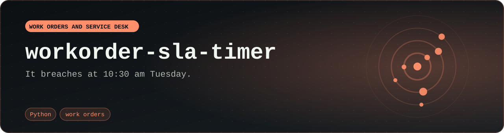

<p align="center"></p>

# workorder-sla-timer

Service-level targets for work orders are written in business hours: an emergency in 4 hours, a routine job in 3 days. A ticket opened at 3:30 pm on a Monday does not breach at 7:30 pm. It breaches at 10:30 am Tuesday. Spreadsheets that subtract timestamps get this wrong, so breaches are found late. This tool computes the real deadline for each ticket from a working calendar and reports which open tickets are fine, at risk or already breached.

## Install

```
cd workorder-sla-timer
python -m pip install -e .
python -m pip install pytest
```

Python 3.10 or newer. No other dependency.

## Usage

```
python -m slatimer examples/tickets.csv --now 2026-03-04T10:00
```

Output:

```
Assessed at 2026-03-04 10:00
ticket   priority  deadline            used  state
T-201    emergency 2026-03-03 10:30   312%  breached
T-203    high      2026-03-04 09:00   112%  breached
T-204    medium    2026-03-04 14:30    81%  at-risk
T-205    medium    2026-03-06 13:45     9%  ok
T-206    low       2026-03-11 16:00    29%  ok
T-208    low       2026-03-13 17:00     3%  ok
T-207    emergency 2026-03-02 12:00   150%  late
T-202    high      2026-03-02 17:00    75%  met
```

Input columns: `ticket_id, priority, opened, closed` with ISO date times. `closed` may be empty. Use `--holiday YYYY-MM-DD` (repeatable) to remove days from the calendar. The exit code is 1 when any open ticket is breached, 2 when the file cannot be read. Rows with bad data are skipped and listed on standard error. The sample data is invented.

## How it works

- The calendar is Monday to Friday, 08:00 to 17:00, minus listed holidays. Targets in business hours: emergency 4, high 8, medium 24, low 72.
- The deadline starts at the opening time (a ticket opened outside hours starts at the next opening) and adds the target hours, using up each day's remaining time before moving to the next working day.
- Elapsed time counts only business hours between the open time and the close time, or the current time for open tickets.
- States: `ok` below 75 percent of the target, `at-risk` at 75 percent or more, `breached` past the deadline. Closed tickets are `met` or `late` by their close time against the deadline.
- `used` is elapsed business hours as a percent of the target.
- Calendar and targets are the `Policy` dataclass in `src/slatimer/core.py`.

## Limits

- One calendar for all tickets. No time zones, daylight saving handling, shifts or 24 hour coverage for emergencies.
- No pause for "waiting on customer" status.
- Priorities are fixed to the four names above unless you change `Policy`.

## License

MIT. Copyright 2026 Yassine Emhamed.
